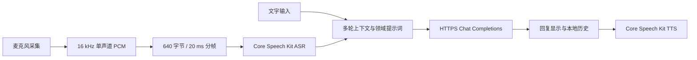

# 和声 AI · 鸿蒙智能语音助手

基于 ArkTS、ArkUI 和 HarmonyOS 原生语音能力的实习项目原型。当前选择云端兼容 Chat Completions API，提供通义千问和 DeepSeek 的地址预设，并允许手动配置其他兼容服务。

## 运行

1. 用 DevEco Studio 打开本目录，等待工程同步。工程当前使用已安装的 SDK 26，兼容版本为 HarmonyOS 6.1.1（API 24）。
2. 连接支持 Core Speech Kit 中文离线识别、中文播报的鸿蒙真机。在工程的 Signing Configs 中完成本机调试签名，然后运行 `entry`。
3. 点击首页右上角设置，填写 **服务地址、模型名称、API Key**，点击“测试连接”，再保存。连接测试会发送一条很短的真实模型请求。
4. 点击麦克风开始说话，说完再点击一次，等待识别、模型回复和自动朗读；也可以直接输入文字。自动朗读可在设置关闭。
5. 历史页面可以恢复对话、继续追问和删除记录。切换学习/通用模式会新建对话，原对话保留。

API Key 只保留在应用进程内存中，不写入源码、本地配置或历史记录。进程重新启动后需要重新填写。问题与最近的对话文本发送到你配置的服务，原始录音不会上传到模型接口。历史记录保存在应用沙箱内，卸载或清除应用数据会移除它们。

通义预设为 `https://dashscope.aliyuncs.com/compatible-mode/v1`，模型示例 `qwen-plus`；可按百炼控制台填写业务空间专属地址。API Key 和地址需要属于同一地域。DeepSeek 预设为 `https://api.deepseek.com`，模型示例 `deepseek-flash`。模型名称最终以服务商控制台可用列表为准。服务地址也支持填写完整的 `/chat/completions` 端点。

## 实现和任务要求

| 任务要求 | 实现 |
| --- | --- |
| 语音交互闭环 | 麦克风 PCM → 原生 ASR → 云端 LLM → 原生 TTS |
| 大模型接入 | HTTPS POST、Bearer 认证、兼容 Chat Completions 协议 |
| 领域强化 | 学习辅导提示词：目标与基础、直观例子、解题步骤、检查理解；另有通用模式 |
| 至少三轮上下文 | 最近 12 轮完整问答与当前提问，最多 24,000 字上下文预算 |
| 历史管理 | 最近 20 段对话，每段保存最近 60 条消息，恢复、删除与异常备份 |
| 异常与体验 | 权限拒绝、无语音、超时、认证/额度错误提示；取消、重试、停止播报、后台释放资源 |

### 数据流



`entry/src/main/ets/model/Assistant.ets` 管理数据模型、上下文策略、回复解析和音频缓冲；`services/ChatService.ets` 管理请求与取消；`services/SpeechService.ets` 管理采集、识别和播报；`services/AssistantStore.ets` 管理设置与历史；`pages/Index.ets` 管理页面和交互状态。

语音采集使用 16 kHz、16 bit、单声道格式。不同大小的采集缓冲被重组为每 20 ms 一帧 640 字节；手动结束时先排空缓冲，再提交识别完成请求。最长采集 55 秒，启动和识别完成各有 10 秒超时。模型连接超时 15 秒、响应等待超时 60 秒，输出限制为 1024 token。本版使用非流式 HTTP 回复，模型响应完成后开始朗读。

上下文窗口按完整问答裁剪，失败和取消的提问不会污染后续上下文。取消会销毁网络请求，并通过请求代次忽略迟到回调。语音切到后台、退出页面或取消时，释放麦克风并停止播报。历史文件通过临时文件写入后重命名，避免中断时覆盖已保存的数据；读取到损坏的历史时保留 `.corrupt时间戳` 备份并提示。

## 验证

运行可重复的核心逻辑检查：

```powershell
node --test scripts/verify.cjs
```

检查脚本使用 DevEco Studio 自带的 TypeScript 编译器，将实际 `.ets` 服务代码转译后执行。默认安装位置是 `D:/DevEco Studio`；其他位置请设置 `DEVECO_STUDIO_ROOT`。检查使用模拟的网络、音频和语音引擎，不能替代真机联调。

本机命令行打包示例：

```powershell
$env:DEVECO_SDK_HOME = 'D:\DevEco Studio\sdk'
$env:JAVA_HOME = 'D:\DevEco Studio\jbr'
& 'D:\DevEco Studio\tools\node\node.exe' 'D:\DevEco Studio\tools\hvigor\bin\hvigorw.js' --mode module -p product=default -p module=entry@default assembleHap --no-daemon
```

构建产物在 `entry/build/default/outputs/default/entry-default-unsigned.hap`。当前工程未配置签名，未签名包不能直接作为正式安装包交付。

### 真机验收与答辩演示

| 步骤 | 操作 | 预期 |
| --- | --- | --- |
| 1 | 设置正确地址、模型和 Key，测试连接 | 提示连接成功 |
| 2 | 语音问“我叫小林，正在学习鸿蒙” | 识别文字、显示回复并朗读 |
| 3 | 追问“请给我一个入门练习” | 根据鸿蒙学习背景推荐练习 |
| 4 | 追问“我叫什么名字，刚才建议了什么练习？” | 正确承接前两轮上下文 |
| 5 | 切后台、重新进入，恢复历史并继续追问 | 麦克风已释放，历史可继续使用 |
| 6 | 使用错误 Key 或断网发送，再修复并重试 | 明确错误提示；失败问题不进入后续上下文 |
| 7 | 回复中点击停止，再输入新问题 | 停止播报，新问题可以正常发送 |
| 8 | 拒绝麦克风权限、保持静音或在录音中退出 | 明确提示或停止采集；文字输入仍可用 |

目前已经通过构建及模拟核心逻辑检查；没有用户 API Key 和已连接设备，真实模型调用、语音识别准确率、音色、延迟及上述验收步骤尚未完成实测。学习模式是提示词领域强化，没有训练或微调模型。本项目没有后台持续监听、唤醒词、系统设备控制或检索知识库功能。

## 官方参考

- [HarmonyOS 语音识别接口](https://developer.huawei.com/consumer/cn/doc/harmonyos-references/hms-ai-speechrecognizer)
- [HarmonyOS 语音合成指南](https://developer.huawei.com/consumer/cn/doc/harmonyos-guides/texttospeech-guide)
- [阿里云百炼兼容 Chat 接口](https://help.aliyun.com/zh/model-studio/compatibility-of-openai-with-dashscope)
- [DeepSeek 首次 API 调用](https://api-docs.deepseek.com/)
- [DeepSeek 多轮对话](https://api-docs.deepseek.com/guides/multi_round_chat/)
